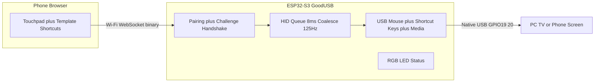

# GoodUSB — a Screen Mouse

Plug an ESP32-S3 into any screen — **PC first**, TV or phone later — and drive
its cursor from your phone's browser. No app to install, no cloud, no account.

## Quickstart

1. Flash: `pio run -t upload && pio run -t uploadfs` (PlatformIO, board `esp32-s3-devkitc-1`).
2. Plug the ESP32-S3 **native USB port** (not the UART port) into the PC.
3. First boot: the LED pulses blue for 60 s — the pairing window.
4. Join the device to your Wi-Fi (set `src/secrets.h` before first flash, or
   rename/re-network later from the app once connected), then open
   `http://goodusb.local` on your phone (same Wi-Fi).
5. Create a 4–8 digit PIN in the app. Done — this phone is now the controller.

## Security (trusted-LAN model)

- Pairing window opens only when unpaired, on BOOT-button hold (3 s), or from
  the authenticated controller — never on every boot.
- The device stores `SHA256(salt ‖ PIN)` and `SHA256(token)` in NVS, never the PIN.
- Every connection answers a fresh nonce challenge
  (`SHA256hex(SHA256hex(token) ‖ ":" ‖ nonce)`); the token itself never
  crosses the LAN after pairing and replays are useless.
- Lost phone: enter the PIN to rotate to a new token (old phone is cut off).
  5 wrong PINs lock unlocks for 60 s.
- Honest limit: traffic is `ws://` (self-signed `wss://` breaks Safari), so
  this stops casual hijack, not a determined attacker sniffing pairing day.

## LED legend (GPIO48 RGB)

Amber boot · **blue pulse pairing** · yellow blink Wi-Fi connecting ·
green dim ready · green controller connected · white flash input ·
red blink error.

## Templates

Preset shortcut panels picked in the app (mouse pad is always present):
**PC Desktop** (arrows, Enter/Esc, Alt+Tab, Desktop, media), **Presentation**
(prev/next slide, Start, Black), **Media/TV** (OK, Back, Home, Play/Pause,
volume), **Phone** (Back, Home, media). Shortcuts use HID keyboard/media
reports under the hood — there is deliberately no typing keyboard.

## Settings (trust the user)

From the app's *Device settings*: device name (= USB + `name.local` network
name, so several GoodUSBs can share one Wi-Fi) and Wi-Fi SSID/password,
stored in NVS and applied on restart.

## Compatibility checklist

- [ ] Windows PC — mouse, buttons, scroll, PC template
- [ ] macOS PC — same (note: GUI+D = Mission Control differences per OS)
- [ ] Linux PC — same
- [ ] Android TV / Tizen / webOS — mouse + Media template (varies by vendor)
- [ ] Android / iPad as host (USB-OTG) — mouse; iOS needs pointer support

## Notes

- Serial logs are on UART0 (USB-CDC is off so the native port can be a mouse).
- Boot self-test is **off** by default (`GOODUSB_BOOT_SELF_TEST` in
  `src/config.h`) — a product never clicks things just because it was plugged in.
- Layout: `src/` firmware (`hid_composite`, `auth`, `settings`, `led_status`,
  `wifi_manager`, `ws_server`, `protocol.h`), `data/` web app, `partitions.csv`.
